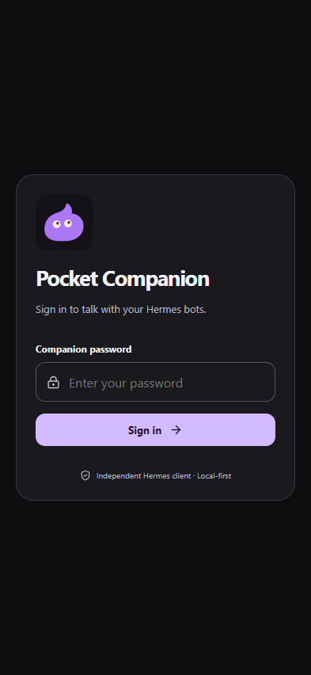
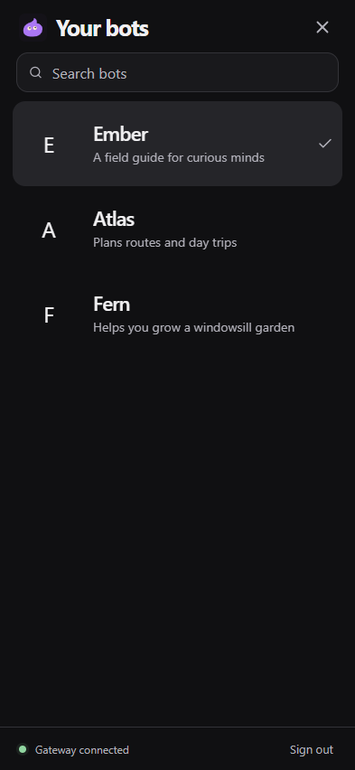
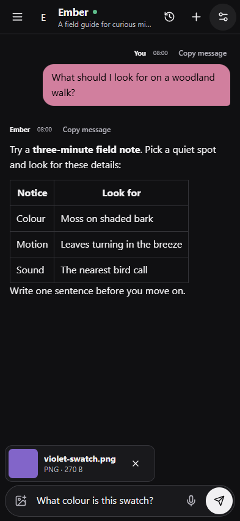

# Install Pocket Companion on Windows

## Before you start

Use the same ordinary Windows account that runs Hermes. Open a bot in Hermes first. You need Windows PowerShell, Task Scheduler, Node.js 22.12 or newer with npm, and network access to fetch the locked packages. Keep the extracted repository in a permanent, user-controlled folder. Use a fresh folder without an existing node_modules. The installer uses npm ci, which replaces dependencies in the selected checkout.

## Run setup

Double-click **Setup Pocket.cmd**, or run this from the extracted folder in PowerShell:

```powershell
.\windows\Install.ps1
```

The installer checks Windows, Node, Hermes paths, its own instance name and the loopback port. It downloads the locked packages, builds the frontend, and attaches briefly to a running Hermes gateway to confirm the native handshake. It never starts a second Hermes runtime. If your home, Python or TUI bootstrap is elsewhere, specify the paths explicitly.

| Option | Purpose |
|---|---|
| `-Instance Pocket` | Name for this installation’s settings and sign-in task. Choose a distinct name for a second copy. |
| `-Port 4177` | Available local port. If occupied, pass a different unused port. |
| `-HermesHome`, `-Python`, `-Bootstrap` | Override discovery using paths from your working Hermes installation. |
| `-Profile` | Check a particular running profile and prefer it on first login. All discovered profiles remain selectable. |
| `-Origin` | Optional exact private HTTPS origin for your own reverse proxy. |

At **New Pocket password**, enter a unique password with at least 16 characters. Confirm it locally. Save it in your password manager. The installer stores a salted scrypt verifier and settings in an access-controlled folder under `%LOCALAPPDATA%\PocketCompanion\<instance>`. There is no default password or password recovery link.

Open the printed loopback URL in a browser **on the host**. Sign in, open the menu, and choose a bot. The plus button starts a separate conversation. The history button opens existing sessions. In the composer, choose the image button to preview a PNG or JPEG, type a question, then send.

<p>  </p>

## Open on your phone

1. For remote access, install Tailscale on the host and phone from the official provider, sign both into the same tailnet and apply your access policy. The host must be awake with Hermes running. [Tailscale installation](https://tailscale.com/download)
2. On the Windows host, **inspect existing routes** with `tailscale serve status` and `tailscale funnel status`. Choose a separate unused HTTPS port and the host’s MagicDNS name. Keep other services’ listeners. If remote access is wanted at install time, supply the corresponding `-Origin`. For an existing Pocket instance, edit only its settings.json `origin` value and restart its task.
3. With owner approval, add the private listener. This example assumes **8444 is free** and Pocket’s actual loopback port is **4177**:

   ```powershell
   tailscale serve --bg --https=8444 http://127.0.0.1:4177
   tailscale serve status
   ```

4. Open the exact HTTPS address printed by Serve on your phone. Confirm that the name and port match Pocket’s configured origin. Sign in. Use Serve only. Keep Funnel, router forwarding and the Hermes gateway outside this setup. [Tailscale Serve](https://tailscale.com/docs/features/tailscale-serve)
5. **Android Chrome:** Open the browser menu, choose **Add to home screen** or **Install app**, and confirm. Launch Pocket from its purple icon. **iPhone Safari:** Choose **Share → Add to Home Screen**, enable **Open as Web App** when offered, then **Add**. **Desktop Chrome or Edge:** Use the install control in the address bar or the browser’s app-install menu. Menu wording varies by browser. [Chrome installation help](https://support.google.com/chrome/answer/9658361)

The saved icon launches Pocket in its own window on supporting browsers. First sign-in can be required again. The screens above are captures of the app with fictional profiles. System install dialogs vary by device.

## Startup, recovery and removal

Setup starts a limited, interactive scheduled task named `Pocket Companion - <instance>`. It starts again at that account’s sign-in. Task Scheduler retries a failed process after one minute up to ten times. To restart, stop that exact task in Task Scheduler, then choose **Run**. Restarting invalidates existing Pocket logins. Hermes retains its conversations.

To reset a forgotten password, remove this Pocket instance and rerun setup. In Task Scheduler, stop and delete only its named task. Remove only its matching folder under `%LOCALAPPDATA%\PocketCompanion`; keep your source checkout. For full removal also remove the Pocket checkout and any private Serve listener you added for it. Review hostname and port before making changes. Hermes settings and history live separately.

## Troubleshooting

| Symptom | Check |
|---|---|
| PowerShell prevents setup | Review the local script and its provenance. Use your organisation’s approved local-script procedure. |
| Hermes connection check fails | Open the desired profile in Hermes. Confirm its home, bootstrap and Python paths. Repeat setup with explicit overrides if necessary. |
| Port or instance exists | Keep the existing installation. Choose a free port and a new instance, or start the existing task. |
| Login failed or expired | Use the Pocket password for this installation. After repeated attempts, wait 15 minutes. After a bridge restart, sign in again. |
| Laptop works, phone fails | Check tailnet membership, Serve status, access rules, HTTPS certificate, exact origin and that the laptop is awake. Loopback on a phone points to the phone itself. |
| Voice input is unavailable | Try a browser supporting speech recognition, grant microphone permission, or use the phone keyboard’s dictation. |
| File is rejected | Select one still PNG or JPEG under the configured limits. Changing a file extension does not change its format. |
