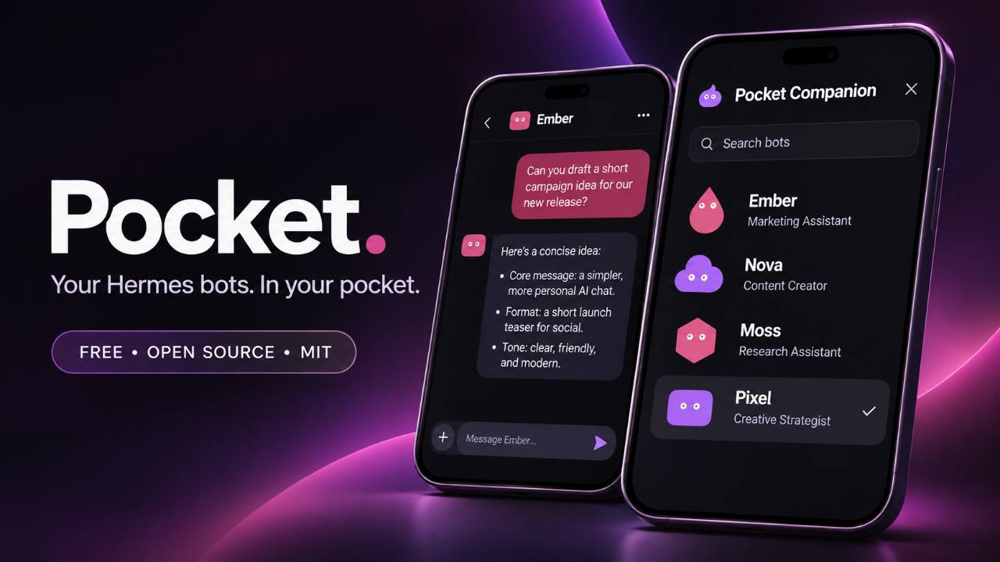
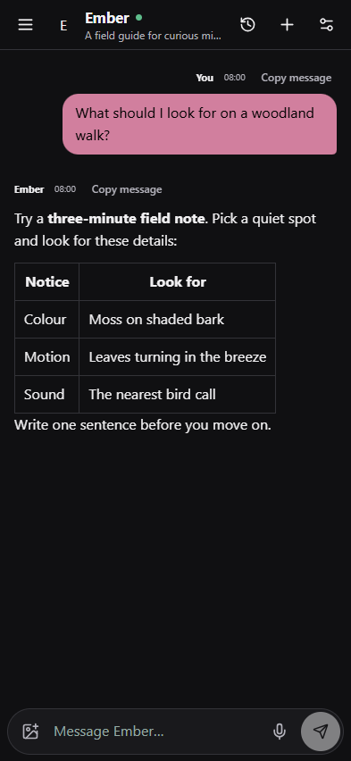
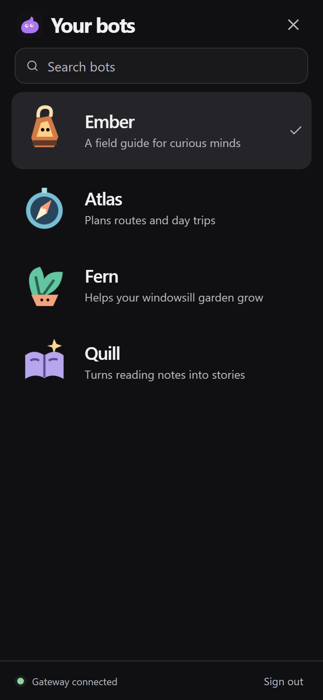
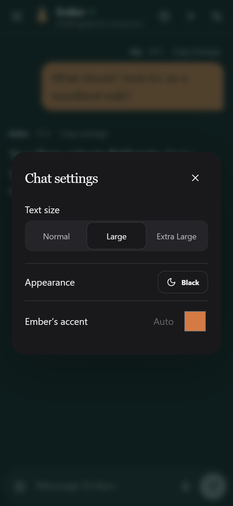

**Pocket Companion** © 2026 Jon Pedlow and Hermes Pocket Companion contributors. [Project MIT licence](LICENSE)

**Avatar artwork in the banner** adapts Hermes Bot Mode designs © 2026 Nous Research. [Avatar MIT licence](licenses/hermes-bot-mode-MIT.txt)

# Pocket Companion

Chat with the bots on your own Hermes Agent installation from a phone or desktop browser. Pocket reads your local profiles and avatars, streams replies and opens the selected bot’s conversation history. It is an independent, unofficial companion for Hermes Agent.

> **Ask your Hermes agent:** “Please install Pocket Companion v1.0.0 from https://github.com/jonpedlow/hermes-pocket-companion, follow HERMES-INSTALL.md, and help me connect my phone.”

The procedure for agents is in [HERMES-INSTALL.md](HERMES-INSTALL.md). Enter your password yourself in the local setup prompt.

  

## Install on Windows

1. Open a bot in your existing Windows Hermes installation. Have Node.js 22.12 or later (with npm) installed for the same Windows user.
2. Download the [v1.0.0 source ZIP](https://github.com/jonpedlow/hermes-pocket-companion/releases/download/v1.0.0/Pocket-Companion-v1.0.0-source.zip) and extract it into its own permanent folder. Double-click **Setup Pocket.cmd**. If you already use the default port, choose another using the [installer options](INSTALL.md).
3. Create your Pocket password when prompted, save it in a password manager, then open the local address printed by setup. The guided installer builds Pocket locally and registers a per-user sign-in task.
4. For phone access, configure private HTTPS and add Pocket to your home screen. [Phone and desktop instructions](INSTALL.md#open-on-your-phone)

Verified on Windows with Hermes v0.23.0 and on an Android phone, including home-screen installation. iOS home-screen installation and microphone transcription are unverified. Linux, macOS and VPS installation have not been verified. Chat requires a connection to the computer running Hermes. [Installation and troubleshooting](INSTALL.md)

## What you can do

- Switch between local bots, open recent conversations, or start a new chat. Hermes stores the transcript. Pocket remembers the selected session per bot in your browser.
- Read streaming Markdown with tables and code blocks. Copy one code block or the whole message. External web links open separately. Raw HTML is skipped.
- Send one still **PNG or JPEG** per message, up to **4 MiB and 32 megapixels**. Pocket validates the bytes, removes metadata and sends a JPEG up to 2048 pixels on the long edge to the selected Hermes profile. Image understanding depends on that profile’s vision capabilities.
- Preview the selected picture. After admission, the card shows the original filename, type and size. Up to three submitted thumbnails stay in memory in the open conversation. Switching or reloading removes those local cards. Hermes retains the transcript.
- Dictate a draft in a browser that supports speech recognition and grants microphone permission. Review the text before sending. The browser determines speech-processing privacy and availability.
- Adjust text size, theme and bot accent on this device. View tool activity and respond to supported one-time approval prompts using Hermes’ existing policy.

WebP, PDF, DOCX, TXT, Markdown file uploads, ZIP, general file transfer and generated-document downloads are outside v1.0. Markdown **text** is supported. Use Hermes Desktop for unsupported interactions such as clarification and interrupt. Pocket resumes stored history through the gateway. Simultaneous cross-client handoff of an active turn is unverified.

## Privacy and licensing

This is a single-owner application. Keep the bridge on loopback and restrict optional Tailscale access to trusted tailnet members. [Security](SECURITY.md)

Original Pocket work is provided under the [MIT licence](LICENSE). Dependencies retain their own terms. Hermes Agent and its profile artwork are obtained separately. Nous Research and xAI do not sponsor or endorse this project. [Third-party notices](THIRD_PARTY_NOTICES.md) · [Licence audit](LICENSE_AUDIT.md) · [Contributing](CONTRIBUTING.md) · [Release notes](CHANGELOG.md)
